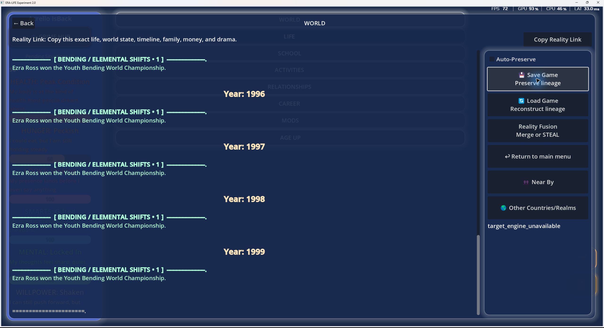
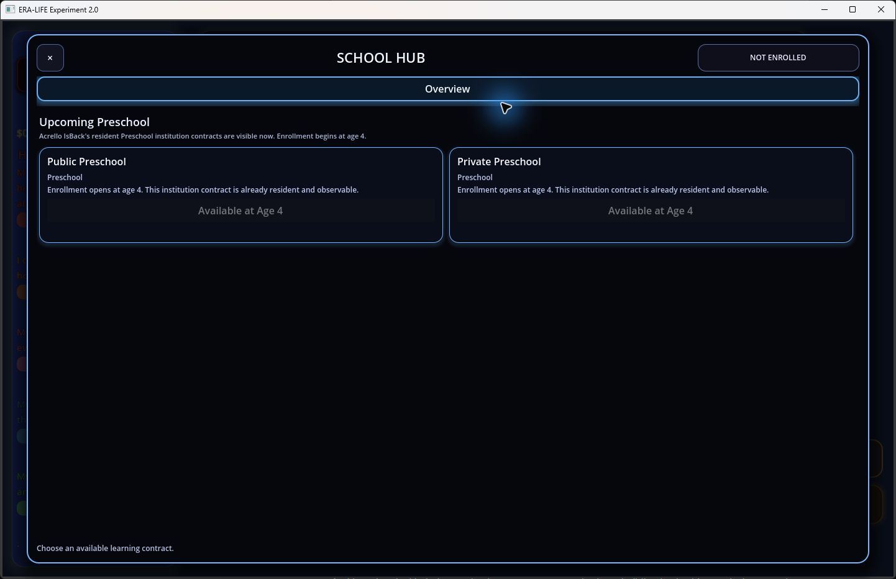
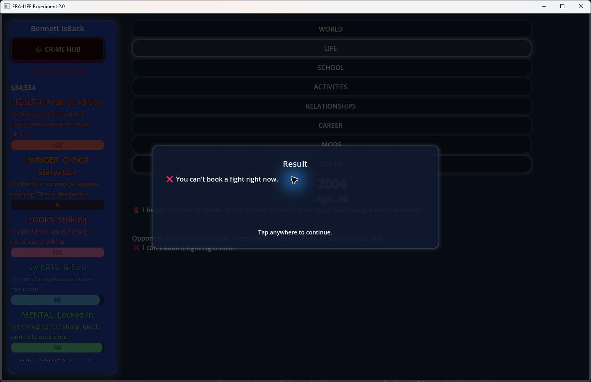
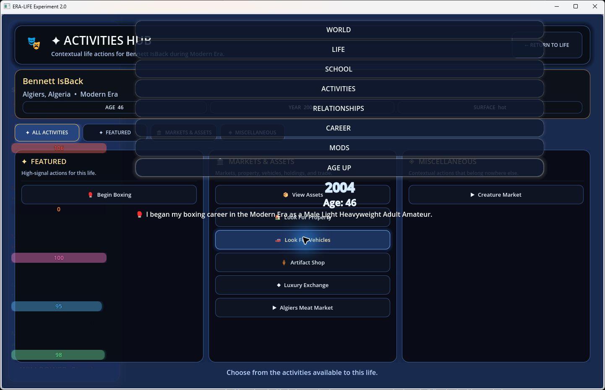

# Windows Demo 0.1.4: bug report and build fingerprints

Test date: 2026-10-03. This contribution records observed behavior and reproduction steps; it does not implement fixes.

## Build identification

- Distribution label: EraLife-Demo-0.1.4-Windows; the [official release page](https://eralife-release.acrello71.workers.dev/) also labels the demo 0.1.4.
- Shipped project metadata: `application/config/name="ERA-LIFE Experiment 2.0"`, `application/config/version="0.1.2"`.
- Runtime: Godot `4.4.1.stable.official.49a5bc7b6`, Vulkan Forward Mobile, NVIDIA RTX 5070.
- Scope: exported Windows demo, guest profile, God Mode, Realistic rules, Modern era, Algiers, birth year 2000. Findings have not been reproduced against a source-built version.

| File | Bytes | SHA-256 |
| --- | ---: | --- |
| EraLife.exe | 97,520,128 | `b493c1d53fb915f7805f360cfe42d1c3126e720dfc234a4b0f2feb99200f9a4b` |
| EraLife.pck | 25,158,816 | `bc1f62ffae0019f7ef91e1b5075e2b819c68bec662d65c252a4ae55ddf2bf8a2` |

The hashes identify the tested binaries; a label mismatch alone does not establish that the gameplay code is old.

## Method and confidence

Gameplay was exercised through UI automation and checked against screenshots and runtime logs. Existing user data was backed up and isolated before testing, then restored and hash-verified. Two disposable lives were created, with a third visible launch used to check recovery. The first life was advanced to age 4, then control switched to its father, age 46. The second life was used for saving checks. An inert loader-test manifest had a disabled provider with no gameplay rows/effects; it is not included in this contribution. No gameplay mod or game-file replacement was used.

These are broad-pass findings, not a guarantee that every bug has been found. Frequencies below distinguish repeated clicks from independent sessions. Confidence applies to the observed result; proposed causes remain unverified. Severity is suggested triage: P1 blocks a core path, P2 disrupts or misleads play, P3 is a packaging/diagnostic defect.

## B01 — Save Game fails and Preserve leaves no recoverable guest life

**Confirmed · P1 · High confidence.** Save Game failed on 2/2 clicks in one fresh life; Preserve/relaunch failed 1/1 time.

1. Create a Realistic Modern guest life and enter play.
2. Open World → Save Game. Repeat.
3. Open World → Load Game.
4. Choose Return to main menu → Preserve.
5. Close the application and relaunch.

**Expected:** Saving creates a recoverable lineage or explains failure; Preserve retains it after relaunch.

**Actual:** Save Game displays `target_engine_unavailable`. Load Game reports no saved lineages, and the disposable profile's `saved_lives` folder contains no files. Preserve returns to the mode menu, but relaunch reports “No unclaimed guest life is saved on this device.”

No existing save was overwritten. A successful reload comparison of age, money, relationships and progress was blocked. Account persistence and auto-preserve were not tested. The error suggests a routing problem, but the cause has not been established.



[Empty Load Lineage list](windows-demo-2026-10-03/103-load-after-save-error.png) · [No saved guest life after Preserve and relaunch](windows-demo-2026-10-03/109-relaunch-no-preserved-guest-life.png)

## B02 — Character panels retain earlier ages and eligibility

**Confirmed · P2 · High confidence.** Three distinct stale surfaces were observed in one life; an independent full rerun was not completed.

1. Create a Modern newborn, open School at age 0, then close it.
2. Age Up twice and open Career.
3. Age Up to 4; reopen School and try Public Preschool.
4. Open Relationships → father → full profile, then Switch To Him.

**Expected:** Panels use the current age/year; preschool becomes available at its stated age-4 threshold.

**Actual:** Career shows Age 0 while the diary shows age 2. At age 4, School still says enrollment begins at age 4 and keeps Public/Private Preschool unavailable; clicking Public has no effect. The father's full profile shows age 42, while switching to him shows age 46 in year 2004. Newborn relationship actions also remain visible for the child at age 4.

Runtime age-up logs record committed years/ages 2001/1, 2002/2, 2003/3 and 2004/4; the switch diagnostic records the father at year 2004, age 46. The shared stale-projection cause is an inference. Switching refreshed the selected father's visible age and adult Career panel; a switch-back school workaround was not tested.



[Age 4 before reopening School](windows-demo-2026-10-03/041-age-up-to-four.png) · [Career shows age 0 after age-up](windows-demo-2026-10-03/037-career-at-age-two.png) · [Father profile at 42](windows-demo-2026-10-03/046-father-relationship-profile.png) · [Switched father at 46](windows-demo-2026-10-03/047-switch-to-father.png)

## B03 — Boxing feedback is hidden, then cannot be dismissed

**Confirmed · P1 · High confidence.** Two booking clicks hid feedback; one session reached the stuck result. A single-request independent rerun was not performed.

1. Switch to an adult and open Activities → Begin Boxing.
2. Choose Amateur → Light Heavyweight.
3. Return to Life and open the glove icon.
4. Click Book Boxing Match twice, then close the Boxing Hub.

**Expected:** Show booking feedback above the hub immediately; rejection dialogs close when tapped as instructed.

**Actual:** The hub stays visible with record 0–0–0 and no explanatory dialog. Closing it reveals “You can't book a fight right now.” Repeated taps inside/outside the card, Escape, and clicking World do not dismiss it. Closing the application was the only tested escape.

The character was hungry, so rejecting a fight may be legitimate. The finding concerns hidden/stuck feedback, not eligibility. The two booking requests may matter.



[Booking screen without visible result](windows-demo-2026-10-03/069-book-boxing-match.png)

## B04 — Starting boxing overlays Life controls on Activities

**Confirmed · P2 · High confidence.** Observed on 1/1 initiation, persisting on a later capture.

1. In Activities, begin an adult Amateur Light Heavyweight boxing career.
2. Dismiss the Boxing Career Started result.

**Expected:** Return to one coherent screen with readable controls.

**Actual:** World/Life/School/etc. controls, diary text and floating stat bars are rendered over the still-open Activities Hub. The overlap remains on a later capture. Return to Life repairs the composition. This does not establish that every activity triggers it.



## B05 — Distribution and internal version labels disagree

**Confirmed · P3 · High confidence.** Persistent metadata discrepancy.

Compare the 0.1.4 distribution/release label with the shipped project metadata above. The internal version is 0.1.2. Consistent or clearly distinguished labels would make bug reports and compatibility checks easier. Use the SHA-256 hashes to identify this build; this finding does not assert old gameplay code.

## B06 — Startup, cache and save diagnostic errors

**Confirmed diagnostic defects · P3 · High confidence.** Icon error across three visible launches; 20 audio-cache errors in each of two created worlds; two save-format errors in the second session.

Launch the demo, prewarm/create a world, attempt Save Game and inspect the runtime log. Expected behavior is successful asset resolution, safe optional cache lookups and correctly formatted save diagnostics.

Observed errors:

```text
ERROR: Cannot open file with icon 'uid://bih0rwtsyfexs'.
   at: set_native_icon (platform/windows/display_server_windows.cpp:3710)
ERROR: The object does not have any 'meta' values with the key 'luxury_exchange_shiny_audio_stream_cache'.
   at: get_meta (core/object/object.cpp:1054)
ERROR: String formatting error: a number is required.
```

The lineage-save diagnostic retained unexpanded `%s`/`%d` placeholders. The second session also reported 277 resources still in use at exit. No crash, audible failure or measured in-play memory leak was established. Slow-subscriber diagnostics are not independently classified as performance bugs.

## Suspected issues and usability feedback

These are not counted as confirmed gameplay bugs.

- **Restaurant purchase — Medium confidence, one attempt:** An $8 Burger Bishop takeout order left displayed bank money $34,534 and hunger 72 unchanged after closing. This could be an unexecuted order or stale HUD; authoritative balance/order state and repetition are needed.
- **Realistic world feed — Medium confidence, one world:** The second Realistic Modern world's history listed yearly Bending Championship wins while player feature toggles were unchecked. Clarify whether Realistic constrains the entire world or only the player, and whether the historical text is regenerated.
- **Hunger jump — Low confidence, one observation:** Adult hunger changed from 72 to 0 after boxing setup without Age Up. Real-time simulation or delayed display refresh may explain it; boxing causation is unproven.
- **School close navigation — High confidence, 2/2 closes:** Closing School removed the central diary/age until Life was clicked. Intended navigation semantics remain uncertain; returning consistently to the previous Life view would be clearer.
- **Creation scrolling — Medium confidence:** Final creation controls were far below the fold with no obvious scrollbar. Scrolling and resizing worked. Scroll speed is not classified as a bug because automation wheel behavior may affect it.

## Coverage and limits

| Area | Result and limit |
| --- | --- |
| Startup/intro | Launch and intro skip work, with diagnostic errors. |
| Creation | Two Realistic Modern lives created; era/defaults/prewarm exercised. |
| Narrative/Household | Explicit Almost Done buttons; unfinished demo paths, not tested gameplay. |
| Life progression | Four age-ups commit in logs; visible first-year/panel refresh is inconsistent. |
| School | Age-0 restriction works; age-4 enrollment remains locked. School progression blocked. |
| Careers | Child/adult browsing works; eligible full-/part-time rows have no vacancies in tested snapshots. Hiring, wages and promotion not tested. |
| Relationships | Family/profile views and switching to father work; stale ages/actions. Marriage and relationship durability not tested. |
| Finances | Restaurant checkout attempted; actual deduction not established. Loans/taxes/investing/property trade not tested. |
| Activities | Boxing setup/hub works; composition and result failures prevent match execution. |
| UI | Creation scrolling, 1442×932 and 2560×1392 window sizes, repeated save/booking requests tested. Arbitrary small sizes not tested. |
| Persistence | Save fails; Preserve exits without recovery. Relaunch works; successful load/state comparison blocked. |

Evidence images are unedited game captures from disposable fictional lives. OS user paths, original saves, identity files, binaries, full raw logs and mod design material are excluded. Other apps were running, so overlay GPU/CPU readings are not attributed to EraLife.
